# Tankzors

Game xe tăng PvE chạy ngay trên trình duyệt, đồ án môn **Lập trình mạng**. Người chơi tạo tài khoản trên website, chơi chiến dịch 3 màn, mua trang bị, nghiên cứu vũ khí và so điểm trên bảng xếp hạng. Không cần cài game, chỉ cần mở một đường link.

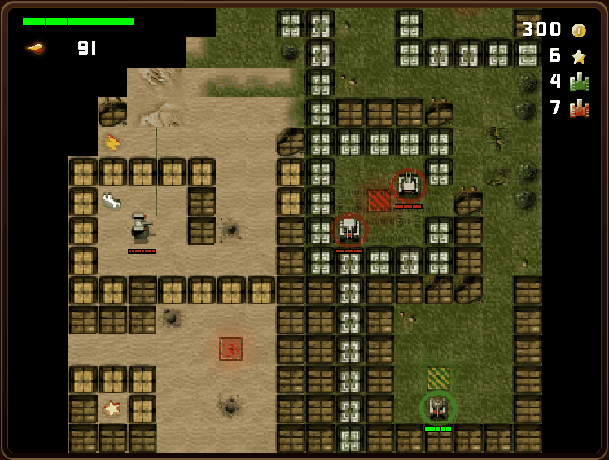

| Lớp | Công nghệ |
|---|---|
| Gameplay và đồ họa | Java, LibGDX 1.12.1 |
| Chạy trên trình duyệt | GWT 2.10 biên dịch Java sang JavaScript (Gradle 8.10.2, JDK 17) |
| Website và API | Spring Boot 3.3.4, Java 21, Thymeleaf, Spring Security |
| Dữ liệu | PostgreSQL 16, Spring Data JPA, Flyway |
| Thời gian thực | Spring WebSocket `/coop`, relay cho co-op (chưa nối vào game) |
| Đóng gói và chạy | Docker Compose, Dockerfile nhiều giai đoạn |

## Mục lục

1. [Dự án này làm gì](#1-dự-án-này-làm-gì)
2. [Chạy thử trong vài phút](#2-chạy-thử-trong-vài-phút)
3. [Hướng dẫn chơi](#3-hướng-dẫn-chơi)
4. [Hệ thống hoạt động thế nào](#4-hệ-thống-hoạt-động-thế-nào)
5. [Cấu trúc thư mục](#5-cấu-trúc-thư-mục)
6. [API](#6-api)
7. [Phát triển](#7-phát-triển)
8. [Cấu hình và cơ sở dữ liệu](#8-cấu-hình-và-cơ-sở-dữ-liệu)
9. [Xử lý lỗi thường gặp](#9-xử-lý-lỗi-thường-gặp)
10. [Trạng thái và hạn chế](#10-trạng-thái-và-hạn-chế)
11. [Tài liệu sâu hơn](#11-tài-liệu-sâu-hơn)
12. [Hướng phát triển và bàn giao](#12-hướng-phát-triển-và-bàn-giao)

## 1. Dự án này làm gì

Tankzors gồm hai phần ghép lại thành một website:

- **Game** viết bằng Java với LibGDX, được GWT biên dịch sang JavaScript để chạy trong trình duyệt. Toàn bộ trận đấu (xe, đạn, AI, va chạm, điểm) được tính ngay trên máy người chơi.
- **Server** viết bằng Spring Boot, lo phần còn lại: website, đăng nhập, cấp bản đồ, lưu kết quả, tiến trình, ví, bảng xếp hạng và trang quản trị.

Ý tưởng mạng cốt lõi: **mô phỏng trận đấu chạy ở client**, còn **dữ liệu tài khoản và giao dịch do server kiểm tra**. Server cấp bản đồ và lượt chơi, nhận các thao tác thay đổi kho/ví trong trận, rồi lưu kết quả cuối trận. Không truyền liên tục toàn bộ world lên server. Campaign vẫn client-authoritative về điểm và thắng/thua; xem [Trạng thái và hạn chế](#10-trạng-thái-và-hạn-chế).

Tính năng hiện có:

- Đăng ký, đăng nhập, phân quyền người chơi và quản trị viên.
- Chiến dịch 3 màn với ba kiểu nhiệm vụ: cướp cờ, tiêu diệt xe địch theo đợt, tiêu diệt toàn bộ cả tháp pháo.
- AI địch biết tuần tra, tìm đường và phá tường đuổi theo người chơi.
- Cửa hàng với đạn, vũ khí, đồ hỗ trợ và cây nghiên cứu. Ví và túi đồ gắn với tài khoản.
- Bảng xếp hạng theo từng màn và trang quản trị tài khoản.

## 2. Chạy thử trong vài phút

Cách chuẩn của dự án là Docker. Máy bạn **không cần** cài Java, Gradle, Maven hay PostgreSQL.

### Yêu cầu

- [Docker Desktop](https://www.docker.com/products/docker-desktop/) đang chạy, cấp cho Docker ít nhất 4 GB RAM vì bước biên dịch GWT khá nặng.
- Git.
- Internet ở lần build đầu tiên để tải image và thư viện.
- Cổng `8081` và `5432` đang trống. Nếu `5432` bận, xem [cách đổi cổng](#cổng-đã-bị-chiếm).

### Các bước

```powershell
# 1. Lấy mã nguồn
git clone https://github.com/NGUYENQUANGCHIEN2701/LapTrinhMang.git
cd LapTrinhMang

# 2. Build và chạy toàn bộ hệ thống
docker compose -f infra/docker-compose.yml up --build -d

# 3. Theo dõi log, đợi đến khi thấy "Started TankzorsApplication"
docker compose -f infra/docker-compose.yml logs -f app
```

Lần đầu có thể mất từ vài phút đến hơn mười phút tùy máy và mạng. Những lần sau nhanh hơn nhiều nhờ cache. Nhấn `Ctrl + C` chỉ thoát khỏi màn hình log, hệ thống vẫn chạy.

Kiểm tra nhanh:

```powershell
docker compose -f infra/docker-compose.yml ps   # cần thấy tankzors-app và tankzors-postgres (healthy)
curl http://localhost:8081/api/health           # {"status":"UP","port":8081}
```

Sau đó mở <http://localhost:8081/>, tạo tài khoản và chơi.

### Địa chỉ và tài khoản

| Trang | Địa chỉ | Cần đăng nhập |
|---|---|---|
| Trang chủ | <http://localhost:8081/> | Không |
| Đăng ký / Đăng nhập | <http://localhost:8081/register>, <http://localhost:8081/login> | Không |
| Menu game (Continue) | <http://localhost:8081/game-menu> | Có |
| Chọn màn | <http://localhost:8081/campaigns> | Có |
| Chơi màn 1 | <http://localhost:8081/play?levelId=campaign_1> | Có |
| Bảng xếp hạng | <http://localhost:8081/leaderboard> | Có |
| Cài đặt âm lượng | <http://localhost:8081/settings> | Có |
| Quản trị | <http://localhost:8081/admin> | Có, quyền admin |

Tài khoản quản trị `admin` được tạo khi chưa tồn tại với mật khẩu lấy từ biến môi trường `ADMIN_PASSWORD`. Docker Compose đặt mặc định `admin123` cho môi trường phát triển. Trong PowerShell, đặt `$env:ADMIN_PASSWORD = "<mật-khẩu-mạnh>"` trước khi chạy Compose. Đổi biến này không đổi mật khẩu tài khoản đã tồn tại. Nếu biến này trống (ví dụ chạy `mvn spring-boot:run` trực tiếp), server không tạo tài khoản admin.

### Dừng và bật lại

```powershell
docker compose -f infra/docker-compose.yml down     # dừng, GIỮ dữ liệu
docker compose -f infra/docker-compose.yml up -d    # bật lại, không build
docker compose -f infra/docker-compose.yml down -v  # dừng và XÓA toàn bộ dữ liệu game
```

Tùy chọn `-v` xóa volume `tankzors_pg_data` và không khôi phục được, kể cả tài khoản, tiến trình và bảng xếp hạng.

## 3. Hướng dẫn chơi

### Bước 1: Tạo tài khoản và vào menu

<table>
<tr>
<td width="50%">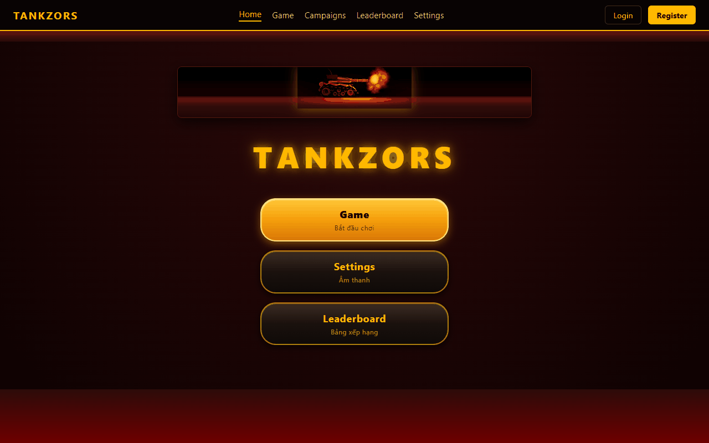</td>
<td width="50%">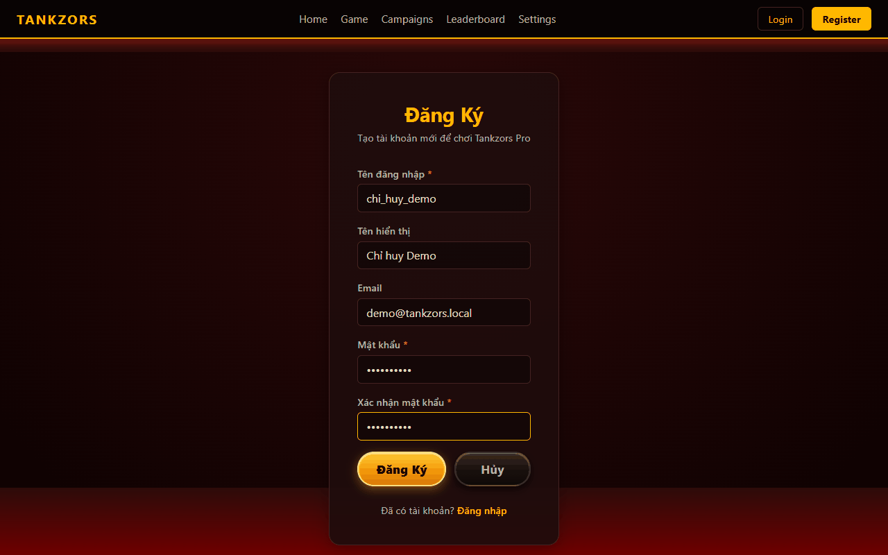</td>
</tr>
<tr>
<td align="center">Trang chủ</td>
<td align="center">Đăng ký: tên đăng nhập 3 đến 50 ký tự, mật khẩu ít nhất 6 ký tự</td>
</tr>
</table>

### Bước 2: Chọn màn

Vào **Game** để tiếp tục màn đang dở bằng nút **Continue**, hoặc vào **Campaigns** để xem danh sách màn. Màn mở lần lượt, và **mỗi màn chỉ thắng được một lần**: thắng xong màn đó bị khóa, chuyển sang trạng thái "Đã hoàn thành". Thua thì chơi lại được không giới hạn.

<table>
<tr>
<td width="50%">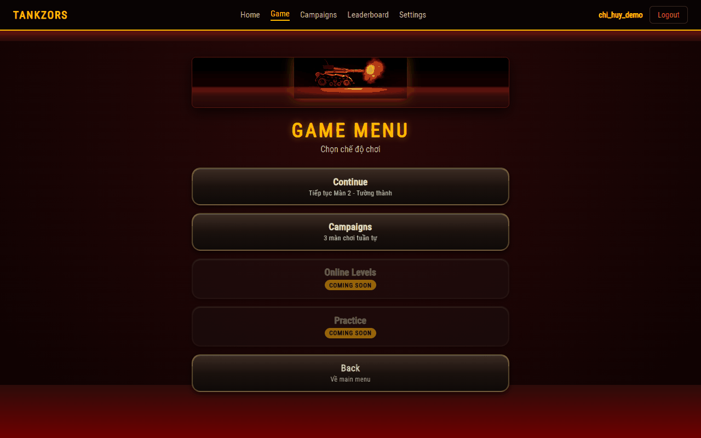</td>
<td width="50%">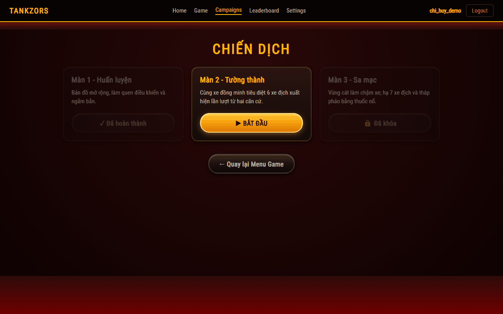</td>
</tr>
<tr>
<td align="center">Menu game. Online Levels và Practice chưa làm</td>
<td align="center">Ba trạng thái màn: đã hoàn thành, đang mở, đã khóa</td>
</tr>
</table>

| Màn | Độ khó | Nhiệm vụ | Thưởng khi thắng |
|---|---|---|---|
| Màn 1 - Huấn luyện | Dễ | Cướp cờ, hoặc hạ xe địch duy nhất | 3 Sao, 100 Xu |
| Màn 2 - Tường thành | Trung bình | Cùng xe đồng minh hạ 6 xe địch ra lần lượt từ hai căn cứ | 3 Sao, 200 Xu |
| Màn 3 - Sa mạc | Khó | Hạ 7 xe địch và tháp pháo. Cát làm xe chạy chậm hơn | 3 Sao, 300 Xu |

### Bước 3: Vào trận

<table>
<tr>
<td width="60%">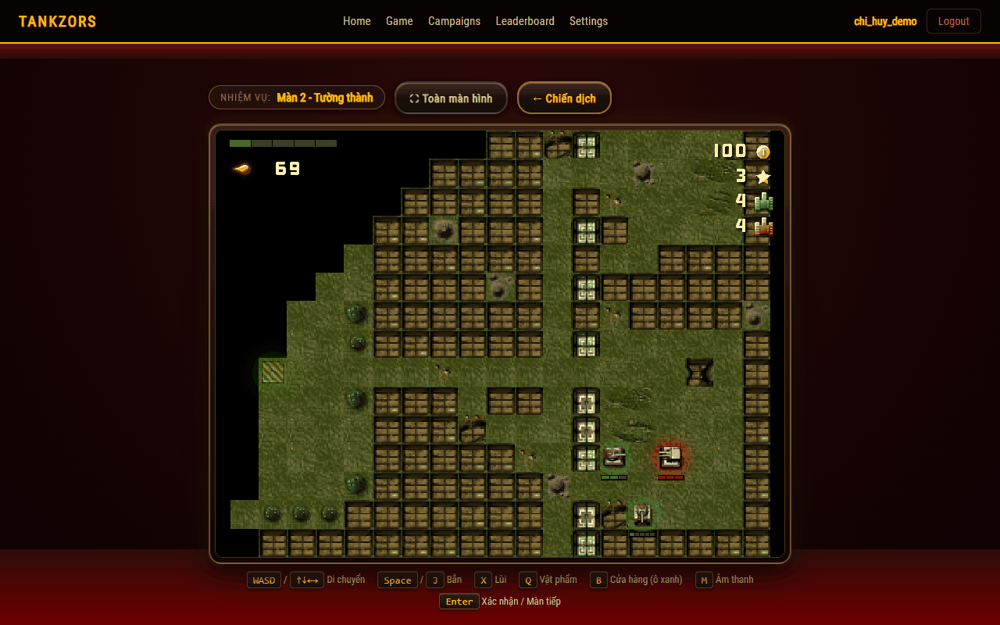</td>
<td width="40%">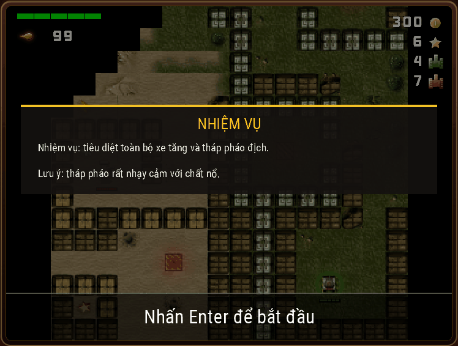</td>
</tr>
<tr>
<td align="center">Trang chơi: game ở giữa, gợi ý phím ở dưới</td>
<td align="center">Bảng nhiệm vụ, có từ màn 2</td>
</tr>
</table>

Game nằm trong khung ở giữa trang. Nếu bàn phím chưa điều khiển được, hãy click một lần vào khung game. Từ màn 2, trước trận có bảng nhiệm vụ, nhấn `Enter` để bắt đầu.

### Đọc màn hình trong trận

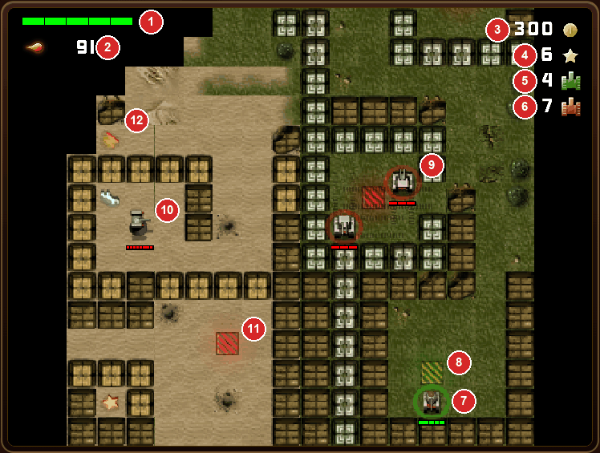

| Số | Thành phần | Ý nghĩa |
|---|---|---|
| 1 | Thanh máu | Máu xe của bạn, mặc định 5 HP |
| 2 | Vũ khí và đạn | Loại đạn đang dùng và số viên còn lại |
| 3 | Xu | Dùng mua đạn và trang bị |
| 4 | Sao | Dùng nghiên cứu công nghệ |
| 5 | Mạng | Số mạng còn lại, mỗi màn có 4 mạng |
| 6 | Địch còn lại | Số mục tiêu cần hạ |
| 7 | Xe của bạn | Vòng xanh lá. Xe đồng minh cũng có vòng xanh |
| 8 | Ô hồi sinh | Ô xanh lá, nơi xuất phát và nơi duy nhất mở được cửa hàng trong trận |
| 9 | Xe địch | Vòng đỏ, kèm thanh máu đỏ |
| 10 | Tháp pháo | Đứng yên, nhiều máu, tự bắn khi bạn vào tầm |
| 11 | Căn cứ địch | Ô đỏ, nơi xe địch xuất hiện |
| 12 | Vật phẩm | Đi vào ô để nhặt: sửa xe, đóng băng, sao, xu, mạng |

Tầm nhìn có giới hạn: vùng xa xe bị che đen và thay đổi khi xe di chuyển.

### Phím điều khiển

| Phím | Tác dụng |
|---|---|
| `W A S D` hoặc mũi tên | Di chuyển theo từng ô |
| `Space` | Bắn, giữ để bắn liên tục |
| `J` | Bắn từng phát |
| `X` | Lùi, giữ nguyên hướng súng |
| `Q` | Mở túi đồ (game tạm dừng) |
| `1` đến `6` | Đổi nhanh vũ khí |
| `B` | Mở cửa hàng khi đứng trên ô hồi sinh xanh |
| `M` | Bật/tắt âm thanh |
| `Enter` | Xác nhận, bắt đầu màn |
| `R` | Chơi lại sau khi thua |
| `Esc` | Đóng menu, về danh sách màn sau khi trận kết thúc |

### Địa hình

| Loại | Xe đi qua | Đạn thường |
|---|---|---|
| Nền đất, cát | Được | Bay qua |
| Gạch | Không | Phá được sau vài phát |
| Bụi cây | Không | Phá được |
| Bê tông, thép | Không | Không phá được |

Bụi cây chặn xe nên hãy bắn mở đường. Ở màn 1, bức tường bê tông ngăn giữa bản đồ không thể bắn xuyên, bạn phải tìm đường vòng để tới cờ. Xe địch cũng biết phá tường để đuổi theo, như trong ảnh dưới: nó đã phá gạch thoát khỏi phòng có căn cứ đỏ và áp sát xe người chơi.

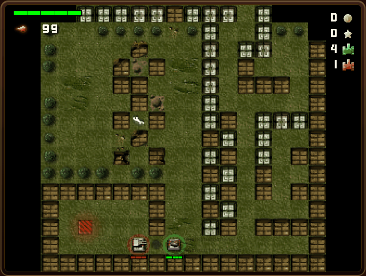

### Túi đồ và cửa hàng

Mỗi người chơi bắt đầu với 99 đạn thường, 3 Bộ sửa xe và 2 Nitro. Trong túi đồ (`Q`), dùng `↑`/`↓` để chọn, `Enter` để trang bị hoặc dùng. Bảng bên cạnh mô tả tác dụng và cách dùng từng món.

Cửa hàng (`B`) dừng trận khi mở. Trong cửa hàng: `↑`/`↓` chọn, `→` mua, `←` bán, `Enter` xem mô tả, `Esc` đóng. Sau mỗi chiến thắng, cửa hàng cũng mở trước khi sang màn kế.

<table>
<tr>
<td width="33%">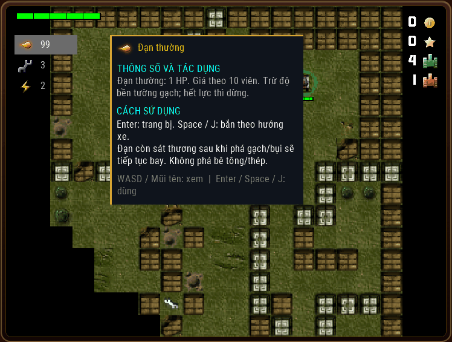</td>
<td width="33%">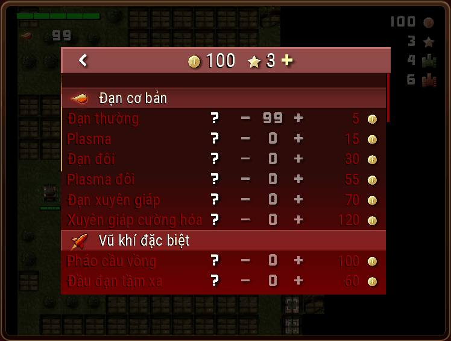</td>
<td width="33%">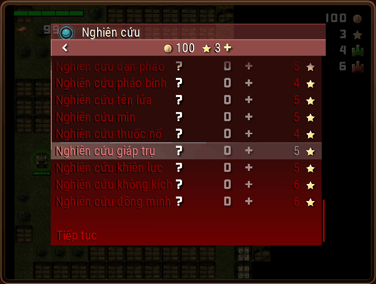</td>
</tr>
<tr>
<td align="center">Túi đồ</td>
<td align="center">Cửa hàng, trả bằng Xu</td>
<td align="center">Nghiên cứu, trả bằng Sao</td>
</tr>
</table>

Một số món trong cửa hàng chưa có gameplay. Danh sách món dùng được nằm ở [hướng dẫn vật phẩm](docs/CLIENT-SHOP-ITEMS-GUIDE.md).

### Kết thúc trận

- **Thắng:** game hiện trạng thái lưu. Sau khi server xác nhận, `Enter` vào cửa hàng rồi sang màn kế, `Esc` về danh sách màn. Kết quả, Sao/Xu, tiến trình và bảng xếp hạng được cập nhật trong cùng transaction. Khi lỗi mạng, game báo rõ và cho nhấn `R` để thử lại.
- **Thua:** khi hết cả 4 mạng. Nhấn `R` để chơi lại, `Esc` để về danh sách màn. Bản browser tiếp tục dùng túi đồ đã lưu; vật phẩm đã tiêu hao không tự hoàn lại. Nếu kho hết mọi loại đạn và ví không đủ 5 Xu mua đạn thường, server cấp lại 99 đạn thường khi bootstrap lượt mới để tránh kẹt tiến trình.

Điểm được tính theo công thức:

```text
điểm = HP còn lại × 10 + số xe hạ được × 200 + max(0, 1000 − số giây × 10)
```

<table>
<tr>
<td width="50%">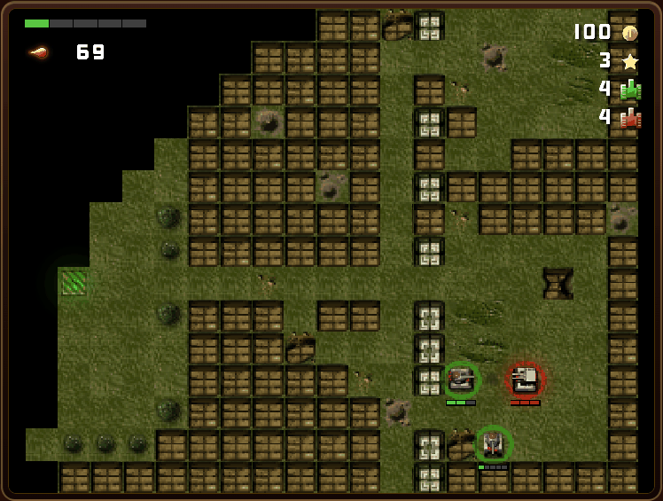</td>
<td width="50%">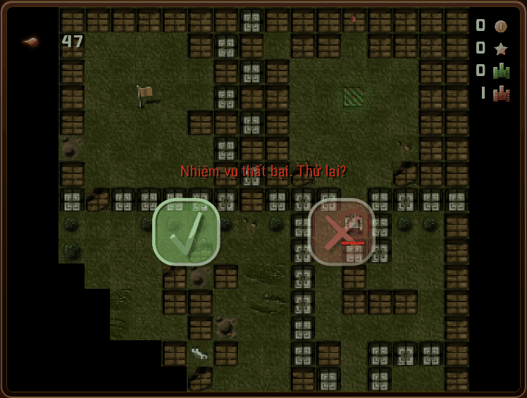</td>
</tr>
<tr>
<td align="center">Màn 2: bạn và xe đồng minh giao tranh với xe địch</td>
<td align="center">Hết mạng: chọn thử lại hoặc thoát</td>
</tr>
</table>

### Bảng xếp hạng và quản trị

Mỗi người chơi giữ điểm cao nhất của từng màn. Trang quản trị cho phép xem thống kê, khóa hoặc xóa tài khoản, xem bảng điểm và lịch sử trận.

<table>
<tr>
<td width="50%">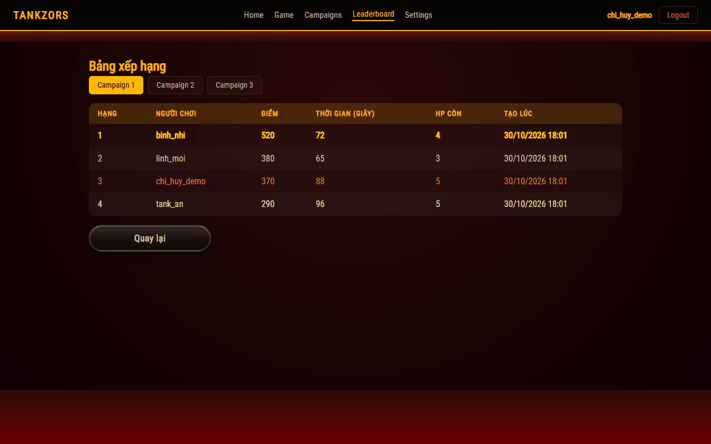</td>
<td width="50%">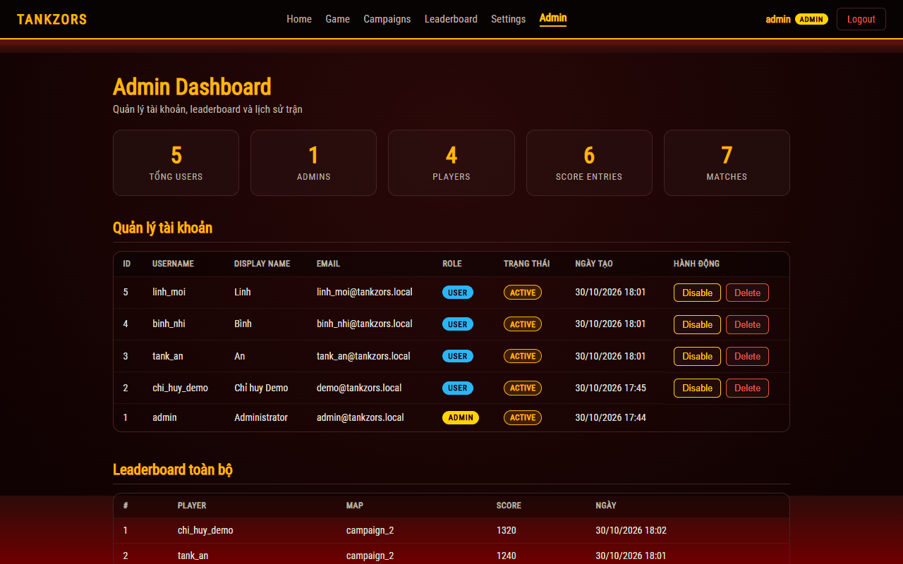</td>
</tr>
<tr>
<td align="center">Bảng xếp hạng (dữ liệu mẫu)</td>
<td align="center">Trang quản trị (dữ liệu mẫu)</td>
</tr>
</table>

## 4. Hệ thống hoạt động thế nào

### Tổng quan

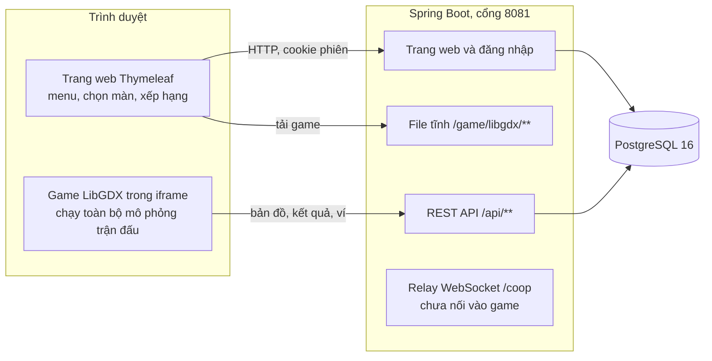

Mọi thứ chạy chung một cổng `8081`. Game không có server riêng: nó được build thành file tĩnh, đóng gói vào `app.jar` rồi do chính Spring Boot phục vụ.

Ranh giới quan trọng nhất của dự án: **server không có xe tăng, đạn, AI hay vòng lặp game**. Luật chơi mới chỉ được thêm trong `game-client/core`.

### Một trận đấu đi qua mạng thế nào

```mermaid
sequenceDiagram
    actor U as Người chơi
    participant G as Game trong trình duyệt
    participant S as Spring Boot
    participant D as PostgreSQL

    U->>S: GET /play?levelId=campaign_1
    S->>D: Màn này đã mở với người chơi chưa?
    S-->>U: Trang có iframe, trình duyệt tải game
    G->>S: GET /api/game/bootstrap
    S-->>G: Bản đồ, runId, ví, túi đồ
    Note over G: Chơi 30 bước mô phỏng mỗi giây.<br/>Chỉ gửi giao dịch tài khoản khi có thay đổi; không gửi world.
    G->>S: POST /api/game/shop/sync (journal giao dịch có revision)
    G->>S: POST /api/game/results kèm runId
    S->>D: Lưu kết quả, mở màn kế, xếp hạng, cộng thưởng
    S-->>G: Các màn đã mở, tổng Sao và Xu
```

Vài cơ chế đáng chú ý:

- **Lượt chơi được cấp và kiểm tra.** Bootstrap lưu `runId`, tài khoản, màn, version và hạn 24 giờ. Server kiểm tra quyền sở hữu trước khi nhận kết quả. Cùng lượt và nội dung là retry; khác nội dung trả `409`. Khóa row theo tài khoản giữ các thay đổi tuần tự đến lúc commit.
- **Thưởng do server tính.** Server lấy thưởng từ map và nghiên cứu đã lưu, rồi cộng ví đúng một lần. Giá trị Sao/Xu client báo không quyết định số dư.
- **Định danh.** Sau khi đăng nhập, mọi dữ liệu game gắn với khóa `user:<tên đăng nhập>` lấy từ phiên, không lấy từ dữ liệu client gửi.

### Bên trong một khung hình

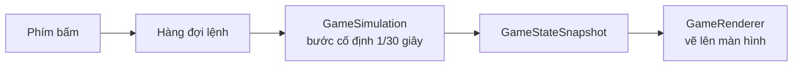

Phím bấm không tác động thẳng vào xe mà xếp vào hàng đợi. Mô phỏng luôn chạy đúng 30 bước mỗi giây dù màn hình 60 hay 144 Hz. Renderer chỉ đọc ảnh chụp trạng thái, không bao giờ sửa thế giới game, nên muốn đổi luật chơi thì sửa `gameplay/`, không sửa `render/`.

### Từ mã nguồn đến chương trình chạy

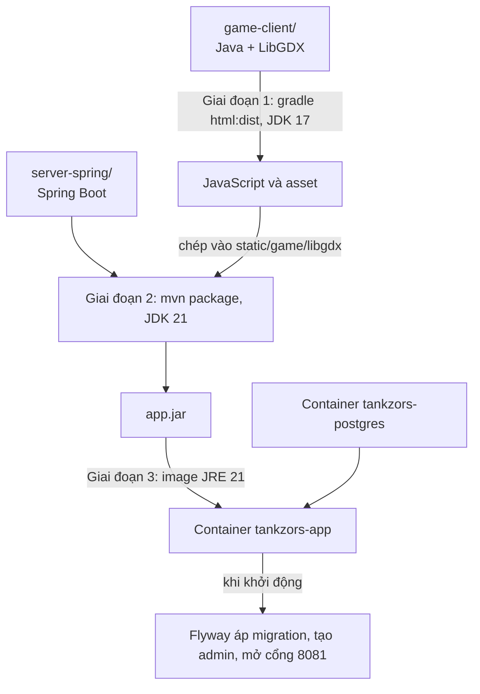

Bundle JavaScript được tạo lại trong mỗi lần build, không được commit và không sửa bằng tay.

## 5. Cấu trúc thư mục

```text
LapTrinhMang/
├── game-client/                 Game, nơi duy nhất chứa gameplay
│   ├── core/                    Mã dùng chung
│   │   └── src/main/java/com/tankzors/client/
│   │       ├── gameplay/        Mô phỏng, AI, va chạm, entity, bản đồ, luật điểm
│   │       ├── session/         Vòng đời lượt chơi: campaign, host, guest
│   │       ├── render/          Vẽ snapshot, radar, tầm nhìn
│   │       ├── input/           Xử lý bàn phím
│   │       ├── shop/            Ví, túi đồ, nghiên cứu
│   │       └── ui/              Cửa hàng, màn hình thắng và thua
│   ├── html/                    Launcher trình duyệt (GWT), gọi REST
│   ├── desktop/                 Launcher desktop để phát triển nhanh
│   └── assets/                  Asset nguồn: ảnh, âm thanh, bản đồ JSON
├── server-spring/               Website và backend, không có gameplay
│   ├── Dockerfile               Build 3 giai đoạn
│   └── src/main/
│       ├── java/com/tankzors/
│       │   ├── web/             Controller trang web và REST
│       │   ├── security/        Đăng ký, đăng nhập, phân quyền, trang admin
│       │   ├── identity/        Xác định người chơi từ phiên
│       │   ├── application/     Use case: tiến trình, xếp hạng, cửa hàng
│       │   ├── result/          Lưu kết quả, chống trùng, kẹp thưởng
│       │   ├── progress/        Entity tiến trình, ví, túi đồ
│       │   ├── leaderboard/     Entity bảng xếp hạng
│       │   ├── map/             Đọc bản đồ để phục vụ API
│       │   └── network/, room/  Relay WebSocket /coop và quản lý phòng
│       └── resources/
│           ├── templates/       Trang Thymeleaf
│           ├── db/migration/    Migration Flyway
│           └── maps/            Bản đồ JSON, phải giống bản trong client
├── infra/                       docker-compose.yml
└── docs/                        Tài liệu kỹ thuật và ảnh README
```

Muốn sửa gì thì mở đâu:

| Muốn sửa | Mở file |
|---|---|
| Luật chơi, đạn, thắng thua | [GameSimulation.java](game-client/core/src/main/java/com/tankzors/client/gameplay/GameSimulation.java) |
| AI xe địch | [BuildsBotBrain.java](game-client/core/src/main/java/com/tankzors/client/gameplay/ai/BuildsBotBrain.java) |
| Phím bấm | [ClientInputProcessor.java](game-client/core/src/main/java/com/tankzors/client/input/ClientInputProcessor.java) |
| Vẽ màn hình, HUD | [GameRenderer.java](game-client/core/src/main/java/com/tankzors/client/render/GameRenderer.java) |
| Vật phẩm, giá | [ShopItem.java](game-client/core/src/main/java/com/tankzors/client/shop/ShopItem.java) |
| API của game | [GameApiController.java](server-spring/src/main/java/com/tankzors/web/GameApiController.java) |
| Lưu kết quả | [ResultService.java](server-spring/src/main/java/com/tankzors/result/ResultService.java) |
| Mở khóa màn | [PlayerProgressService.java](server-spring/src/main/java/com/tankzors/application/PlayerProgressService.java) |
| Phân quyền | [SecurityConfig.java](server-spring/src/main/java/com/tankzors/security/SecurityConfig.java) |
| Bản đồ | [game-client/assets/maps/](game-client/assets/maps/) và [server-spring/.../maps/](server-spring/src/main/resources/maps/), hai bản phải giống nhau |

## 6. API

Trừ `/api/health`, mọi API đều cần phiên đăng nhập (cookie `JSESSIONID`).

| Phương thức | Đường dẫn | Mô tả |
|---|---|---|
| `GET` | `/api/health` | Kiểm tra server còn sống |
| `GET` | `/api/game/bootstrap?levelId=campaign_1` | Lấy bản đồ, `runId`, ví, túi đồ. Trả `403` nếu màn chưa mở hoặc đã thắng |
| `POST` | `/api/game/results` | Gửi kết quả trận. `400` khi dữ liệu sai, `409` khi trùng `runId` khác nội dung |
| `GET` | `/api/game/account` | Lấy định danh, số dư và revision để khôi phục hàng đợi browser |
| `POST` | `/api/game/shop/sync` | Gửi giao dịch có `requestId`, `expectedRevision`; server kiểm tra giá, kho và nghiên cứu |
| `GET` | `/api/progress` | Danh sách màn đang chơi được |
| `POST` | `/api/progress/reset` | Đặt lại tiến trình về màn 1 (cần CSRF token) |
| `GET` | `/api/leaderboard/{mapId}` | Top điểm của một màn |

Ví dụ kết quả gửi lên `POST /api/game/results`:

```json
{
  "runId": "run-bbaa388a-b093-461c-a9c0-69a442c630f8",
  "mode": "CAMPAIGN",
  "levelId": "campaign_1",
  "mapVersion": "v1",
  "status": "VICTORY",
  "score": 370,
  "hpRemain": 5,
  "aiKills": 1,
  "elapsedSeconds": 88,
  "starsEarned": 3,
  "coinsEarned": 100
}
```

WebSocket `/coop` dùng cho co-op, gói tin theo [giao thức v2](docs/protocol-v2.md). `/game/libgdx/**` chỉ là file tĩnh, không phải WebSocket gameplay.

## 7. Phát triển

### Sau khi sửa code

```powershell
docker compose -f infra/docker-compose.yml up --build -d
```

`docker compose restart app` chỉ khởi động lại image cũ, **không đủ** sau khi sửa code. Sau khi build xong, nhấn `Ctrl + Shift + R` trong trình duyệt để bỏ cache JavaScript.

Muốn tự build lại mỗi khi lưu file (Compose 2.22 trở lên), giữ terminal này mở:

```powershell
docker compose -f infra/docker-compose.yml up --build --watch
```

### Chạy không dùng Docker

Chỉ cần khi muốn chạy server hoặc game trực tiếp trên máy. Cần **JDK 21 và Maven 3.9+** cho server, **JDK 17** cho client (JDK 24 sẽ báo lỗi `Unsupported class file major version 68`).

```powershell
# 1. Chỉ bật PostgreSQL
docker compose -f infra/docker-compose.yml up -d postgres

# 2. Build game và chép bundle vào server (JDK 17)
cd game-client
.\gradlew.bat html:copyToServer
cd ..

# 3. Chạy server (JDK 21)
mvn -f server-spring/pom.xml spring-boot:run
```

Để thử gameplay nhanh mà không cần server hay trình duyệt, chạy bản desktop:

```powershell
cd game-client
.\gradlew.bat desktop:run --args="--level campaign_1"
```

### Kiểm thử

Docker build bỏ qua test, nên hãy chạy test riêng trước khi commit. Test server dùng H2 nên không cần PostgreSQL.

```powershell
# Nếu đã cài toolchain trên máy
mvn -f server-spring/pom.xml test               # JDK 21
cd game-client; .\gradlew.bat core:test; cd ..  # JDK 17

# Hoặc chạy trong container, không cần cài gì
docker run --rm -v "${PWD}/server-spring:/src:ro" maven:3.9-eclipse-temurin-21 sh -c "cp -r /src /w && cd /w && mvn -B -ntp test"
docker run --rm -v "${PWD}/game-client:/src:ro" gradle:8.10.2-jdk17 sh -c "cp -r /src /w && cd /w && gradle --no-daemon core:test"
```

Đợt sửa ngày 09/11/2026: **113 test server và 199 test core đạt**, GWT/JDK 17 và JAR build thành công; ba kịch bản browser về lưu/retry/conflict/reload đạt. Docker/PostgreSQL chưa kiểm chứng vì môi trường thiếu CLI/daemon hoạt động. Xem phạm vi thực tế trong [báo cáo sửa lỗi](docs/CODE-REVIEW.md).

Khi bàn giao phiên bản khác, đọc kết quả mới tại `server-spring/target/surefire-reports/` và `game-client/core/build/reports/tests/test/index.html`; không lấy số lượng test của mốc cũ làm bằng chứng. Cách chạy browser regression và checklist nằm trong [hướng dẫn phát triển](docs/DEVELOPMENT.md).

### Quy ước

- Gameplay mới chỉ thêm trong `game-client/core`, kèm test trong `game-client/core/src/test`.
- Thay đổi service hoặc controller của Spring cần test H2 hoặc MockMvc.
- Không sửa file sinh ra trong `server-spring/src/main/resources/static/game/libgdx`.
- Không sửa migration đã áp dụng, hãy tạo file phiên bản mới.
- Đổi schema bản đồ thì cập nhật cả `game-client/assets/maps` lẫn `server-spring/src/main/resources/maps`.
- Thay đổi chạm cả client và server phải kiểm tra lại bằng Docker build.

## 8. Cấu hình và cơ sở dữ liệu

Các biến môi trường chính:

| Biến | Mặc định | Ý nghĩa |
|---|---|---|
| `DB_URL` | `jdbc:postgresql://localhost:5432/tankzors` | Địa chỉ database |
| `DB_USER` | `tankzors` | Tài khoản database |
| `DB_PASSWORD` | `tankzors_dev_password` | Mật khẩu database, chỉ dùng khi phát triển |
| `SERVER_PORT` | `8081` | Cổng Spring Boot khi chạy ngoài Docker |
| `POSTGRES_HOST_PORT` | `5432` | Cổng PostgreSQL mở ra máy host |
| `ADMIN_PASSWORD` | Compose: `admin123`; chạy trực tiếp: không tạo admin nếu trống | Mật khẩu tạo admin ban đầu, không phải cơ chế đổi mật khẩu |

Xem dữ liệu trực tiếp:

```powershell
docker exec -it tankzors-postgres psql -U tankzors -d tankzors
```

Các bảng chính, do Flyway tạo từ `server-spring/src/main/resources/db/migration`:

| Bảng | Lưu gì |
|---|---|
| `app_user` | Tài khoản, mật khẩu BCrypt, vai trò |
| `player_progress` | Màn đã mở và đã thắng của từng người chơi |
| `player_totals` | Số dư Sao/Xu và revision của tài khoản |
| `player_shop_state` | Nghiên cứu và túi đồ dạng JSON |
| `game_run` | Lượt đã cấp, chủ sở hữu, hạn dùng và pickup đã ghi nhận |
| `shop_request` | Khóa và hash chống áp dụng lại giao dịch |
| `match_result` | Lịch sử trận, `run_id` là khóa chống trùng |
| `leaderboard` | Điểm cao nhất theo người chơi và màn |

## 9. Xử lý lỗi thường gặp

### Cổng đã bị chiếm

Đổi cổng PostgreSQL phía máy host, ứng dụng trong Compose vẫn nối tới `postgres:5432`:

```powershell
$env:POSTGRES_HOST_PORT = "5433"
docker compose -f infra/docker-compose.yml up --build -d
```

Cổng `8081` được ghi cố định trong [infra/docker-compose.yml](infra/docker-compose.yml). Nếu bị chiếm, hãy tắt chương trình đang dùng cổng hoặc đổi dòng `"8081:8081"` thành `"9000:8081"`.

### Build Docker lỗi khi tải thư viện

Các lỗi như `Unknown host repo.maven.apache.org`, `Temporary failure in name resolution` hay `Premature end of Content-Length` thường do mạng hoặc DNS tạm thời. Kiểm tra Internet rồi chạy lại lệnh `up --build -d`. Thư viện đã tải được cache nên lần sau tiếp tục được.

### Game hiện màn hình đen hoặc không tải

1. Nhấn `Ctrl + Shift + R`.
2. Mở `F12`, xem tab **Console** có lỗi gì, và kiểm tra trình duyệt có bật WebGL không.
3. Xem log: `docker compose -f infra/docker-compose.yml logs --tail 200 app`.
4. Nếu báo thiếu asset, build lại bằng `up --build -d`.

### Xe không di chuyển

Click vào khung game để chuyển tiêu điểm bàn phím vào iframe. Nếu đang mở túi đồ hoặc cửa hàng, nhấn `Esc` trước.

### Nhấn `B` không mở cửa hàng

Trong trận, xe phải đứng trên ô hồi sinh màu xanh lá. Rời ô đó thì không mở được.

### Vào màn bị đưa về trang chọn màn

Màn đó chưa mở hoặc đã thắng. Mỗi màn chỉ thắng được một lần.

### Thắng rồi nhưng màn kế không mở hoặc không có điểm

Đọc thông báo lưu trong game và kiểm tra `POST /api/game/results` ở Network. Lỗi mạng/5xx được retry theo thứ tự; `401` cần đăng nhập lại. `400/409` không được coi là thành công: game yêu cầu nạp lại dữ liệu server, giữ bản request bị từ chối riêng để chẩn đoán. Bảng xếp hạng chỉ giữ điểm tốt nhất.

### Server báo Flyway `Validate failed`

Đối chiếu file migration với checksum và schema trước. Không sửa migration đã áp dụng; tạo migration mới. Chỉ dùng `down -v` khi chủ đích xóa database thử. Với dữ liệu cần giữ, backup và thử restore trước khi thay schema; xem [database README](server-spring/src/main/resources/db/README.md).

## 10. Trạng thái và hạn chế

Đã hoàn thiện: chiến dịch 3 màn trên trình duyệt, tài khoản, tiến trình, cửa hàng, bảng xếp hạng, trang quản trị.

Chưa hoàn thiện:

- **Co-op chưa dùng được.** Relay `/coop`, trang phòng và lớp host/guest đã có trong code nhưng chưa nối vào game. Trong menu, Online Levels và Practice đang là "Coming soon".
- **`/load-game` chỉ là trang giữ chỗ.**
- **Một số món trong cửa hàng chưa có gameplay**, xem [hướng dẫn vật phẩm](docs/CLIENT-SHOP-ITEMS-GUIDE.md).
- **Tải lại trang không khôi phục world đang chơi.** Hàng đợi ghi tài khoản/kết quả được lưu trong `sessionStorage` theo tài khoản và gửi lại trước bootstrap, nếu trình duyệt cho phép storage. Đóng hẳn tab hoặc xóa storage có thể làm mất request chưa gửi.

Hạn chế về an toàn, cần biết trước khi đưa ra Internet:

- **Điểm và thắng/thua vẫn do client báo.** Có kiểm tra lượt đã cấp, owner, map/version và giới hạn số liệu; server không replay trận để chứng minh kết quả. Bảng xếp hạng hiện phù hợp đồ án/demo hơn là thi đấu có chống gian lận.
- **Không xác minh được đường đi và thao tác thật trong trận.** Server kiểm tra catalog, tiền, số lượng, lượt và pickup đúng ô map, nhưng không biết xe có thực sự đến ô đó hay số đạn báo đã dùng có đúng không. Không coi cơ chế này là chống gian lận hoàn chỉnh.
- **Mật khẩu mặc định.** `ADMIN_PASSWORD=admin123` và mật khẩu database trong Compose chỉ dành cho phát triển.

## 11. Tài liệu sâu hơn

| Tài liệu | Nội dung |
|---|---|
| [docs/README.md](docs/README.md) | Điểm bắt đầu và thứ tự đọc tài liệu cho người tiếp quản |
| [docs/DEVELOPMENT.md](docs/DEVELOPMENT.md) | Cách thêm gameplay, màn, vật phẩm, API; test và tiêu chí bàn giao |
| [docs/CODE-REVIEW.md](docs/CODE-REVIEW.md) | Lỗi tiềm ẩn, bằng chứng trong code, cách tái hiện và hướng khắc phục |
| [game-client/README.md](game-client/README.md), [server-spring/README.md](server-spring/README.md), [infra/README.md](infra/README.md) | Hướng dẫn theo module và vận hành Docker |
| [docs/flows/](docs/flows/README.md) | Trace từng luồng theo code: đăng nhập, vào trận, vòng lặp game, lưu kết quả, tiến trình, cửa hàng, xếp hạng, build. **Nên đọc đầu tiên nếu muốn hiểu code** |
| [docs/architecture.md](docs/architecture.md) | Ranh giới trách nhiệm và quy tắc phụ thuộc |
| [docs/networking.md](docs/networking.md) | REST campaign và WebSocket co-op |
| [docs/protocol-v2.md](docs/protocol-v2.md) | Giao thức relay co-op |
| [docs/CODEBASE-GUIDE.md](docs/CODEBASE-GUIDE.md) | Hướng dẫn đọc codebase |
| [docs/CLIENT-SHOP-ITEMS-GUIDE.md](docs/CLIENT-SHOP-ITEMS-GUIDE.md) | Vật phẩm đang hoạt động và cách dùng |
| [docs/runbook.md](docs/runbook.md) | Thao tác vận hành |

Khi có khác biệt về cách chạy, README này và [infra/docker-compose.yml](infra/docker-compose.yml) là nguồn hiện hành.

## 12. Hướng phát triển và bàn giao

Người mới nên chạy Docker, chơi một màn, đọc [chỉ mục tài liệu](docs/README.md), rồi lần theo `LocalCampaignSession`, `GwtAppBridge`, `GameApiController` và các service. [DEVELOPMENT](docs/DEVELOPMENT.md) hướng dẫn thêm màn, vật phẩm, API và test. [CODE-REVIEW](docs/CODE-REVIEW.md) ghi lại cách khắc phục 10 vấn đề đã rà soát cùng giới hạn xác minh.

### Nền tảng đã bổ sung

- Lượt campaign có metadata cấp phát, owner, map/version và hạn dùng.
- Server kiểm tra giao dịch theo catalog; thưởng, tiến trình và leaderboard được ghi cùng transaction.
- Giao dịch có revision và request ID; browser gửi tuần tự, giữ nguyên request khi retry và lưu hàng đợi qua reload trong cùng tab.
- Game chờ xác nhận trước khi sang màn; lỗi lưu được hiển thị. Khóa/xóa tài khoản làm phiên cũ bị từ chối và đóng kết nối co-op.
- Contract `MATCH_STARTED` đã có danh sách thành viên và run ID đúng. Launcher co-op vẫn là phần cần làm tiếp.

### Công việc tiếp theo

| Ưu tiên | Phạm vi | Tiêu chí hoàn thành |
|---|---|---|
| 1 | CI chạy core/Spring test, GWT và Docker với PostgreSQL | Mỗi PR có kết quả tự động; kiểm tra migration từ bản trước và test transaction đồng thời trên PostgreSQL |
| 2 | Hoàn thiện co-op lobby → launcher → host/guest | Hai browser có hai xe; guest chỉ gửi input; host gửi snapshot; xử lý rời phòng, timeout và rematch |
| 3 | Củng cố protocol co-op | Kiểm tra phase/run/sequence, giới hạn lưu lượng, đủ dữ liệu snapshot, chính sách lưu kết quả co-op rõ ràng |
| 4 | Gom catalog campaign và kinh tế | Thêm màn/vật phẩm không bỏ sót metadata, thứ tự chuyển màn hoặc giá; có test parity và schema |
| 5 | Mở rộng nội dung | Nhiệm vụ, AI, màn và trang bị mới nằm trong core, có test và thử desktop/browser |
| 6 | Vận hành môi trường dùng chung | TLS, credential riêng, phân trang admin, dọn lượt/giao dịch cũ theo chính sách, backup/restore và theo dõi lỗi |

Nếu muốn chơi lại màn đã thắng hoặc thay đổi thưởng, cần thiết kế cùng lúc quyền bootstrap, thưởng lần đầu, reset và leaderboard. Nếu muốn chống gian lận mạnh hơn, cần quyết định kiến trúc riêng; cấp run ID và kiểm tra giao dịch không chứng minh điểm số client là thật.

### Quy tắc khi mở rộng

Gameplay ở `game-client/core`; Spring giữ web, API, identity, persistence, room và relay. Co-op dùng protocol v2 tại `/coop`. Không tạo gameplay engine thứ hai trong Spring, không sửa bundle sinh ra bằng tay và không sửa migration đã áp dụng.

Mỗi PR mô tả hành vi trước/sau, dữ liệu/protocol có đổi không và kết quả test thực tế. Cập nhật README module, tài liệu flow liên quan và chạy pipeline Docker cho thay đổi tích hợp. Checklist ở [DEVELOPMENT](docs/DEVELOPMENT.md#6-kiểm-tra-và-bàn-giao).
